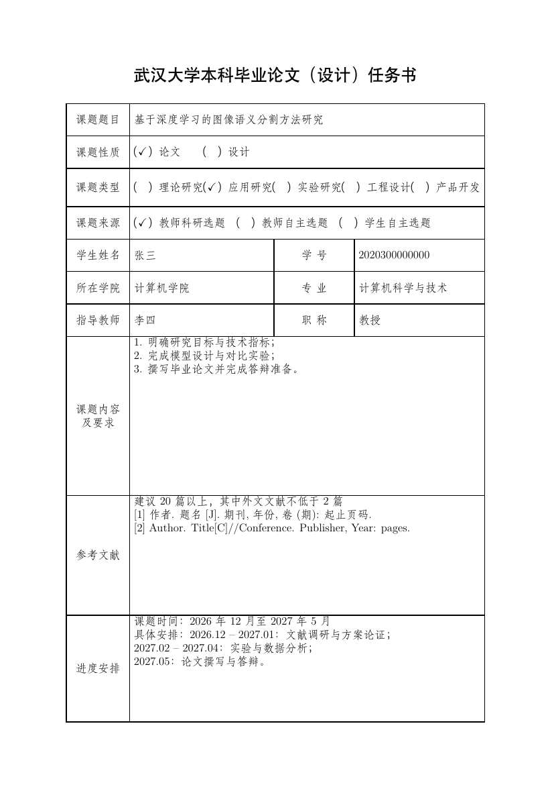
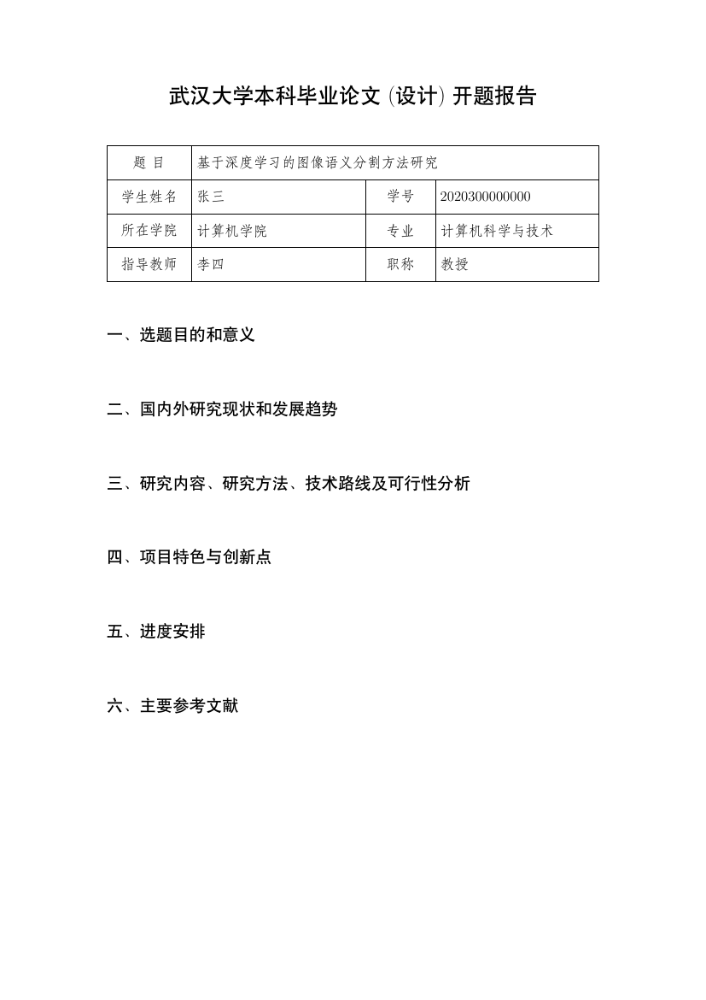
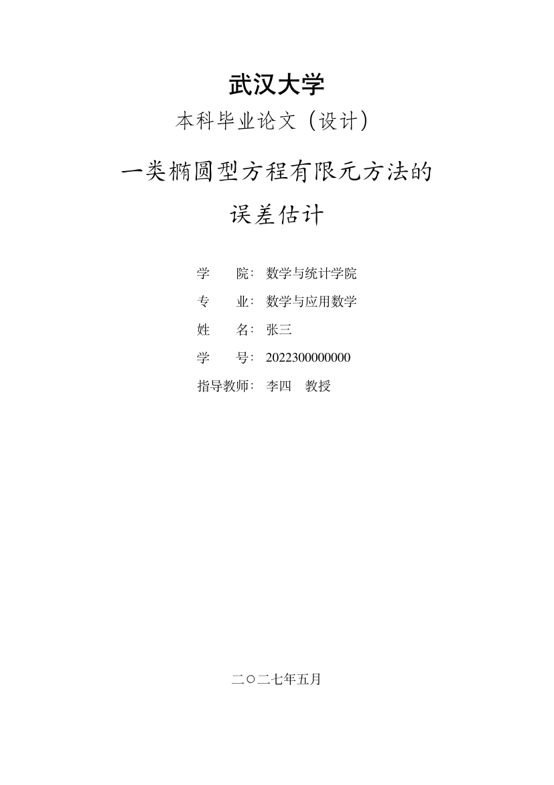
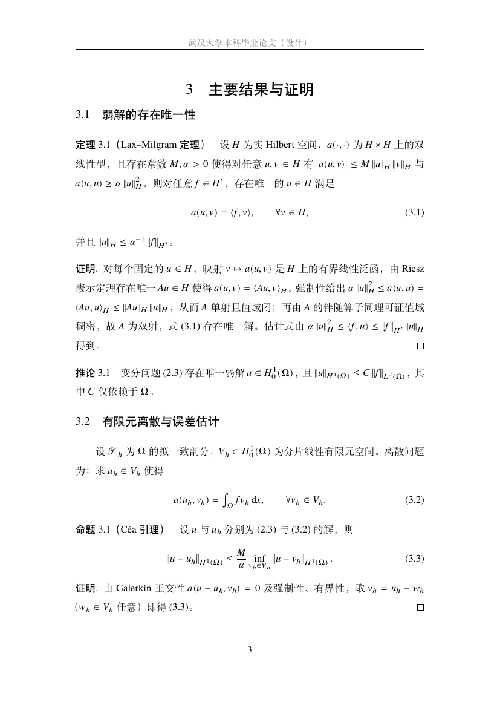

# BachelorThesisTemplate

武汉大学**数学与统计学院**本科毕业论文全套 LaTeX 模板，包含三份可直接编译的文档：

- **任务书** `taskbook.tex` —— 按学院 Word 表单还原的一页表格
- **开题报告** `proposal.tex` —— 信息表 + 六方面正文骨架
- **毕业论文正文** `thesis/main.tex` —— 数院版论文模板：封面、原创性声明、中英文摘要、目录、主要符号表、数学定理与证明、数值实验、GB/T 7714 参考文献、致谢、附录

## 预览

| 任务书 | 开题报告 |
| :---: | :---: |
|  |  |
| **论文封面** | **定理与证明页** |
|  |  |

表单两份各 1 页 A4；论文正文示例为 17 页。仓库中附有编译好的 `taskbook.pdf`、`proposal.pdf` 和 `thesis/main.pdf`。

## 项目结构

| 路径 | 说明 |
| --- | --- |
| `whu-form.sty` | 两份表单的公共样式：字体、字段、勾选框、固定行高单元格 |
| `taskbook.tex` / `proposal.tex` | 任务书、开题报告 |
| `thesis/whu-math-thesis.cls` | **数院版论文文档类**（版式、定理环境、数学宏、封面/声明/摘要） |
| `thesis/main.tex` | 论文主文件，顶部为填写区，用 `\include` 组织各章 |
| `thesis/pages/` | 摘要、符号表、第 1–5 章、致谢、附录 |
| `thesis/ref/refs.bib` | 参考文献库（BibTeX） |
| `thesis/figures/` | 图片目录；放入 `whulogo.pdf` 可在封面自动插入校徽 |
| `preview/` | 预览图 |
| `Makefile` / `.gitignore` | 一键编译；忽略 LaTeX 中间产物 |
| `THIRD_PARTY_NOTICES.md` | 参考项目与 MIT 许可声明 |

> 两份表单的 `.tex` 必须与 `whu-form.sty` 同目录；论文正文请在 `thesis/` 目录内编译（章节与文献库使用相对路径）。

## 环境要求

- **TeX Live 2025 / MacTeX 2025**（完整版），引擎用 **XeLaTeX**；论文正文还需要 `bibtex`
- 主要宏包：`ctex`、`fontspec` / `unicode-math`、`geometry`、`fancyhdr`、`tocloft`、`amsmath` / `amsthm` / `mathtools`、`pgfplots`、`algorithm2e`、`booktabs`、`natbib` + `gbt7714`、`hyperref`
- 字体：中文 **Fandol**（宋/黑/仿宋/楷），西文与数学 **TeX Gyre Termes** —— 均随 TeX Live 提供，无需安装系统字体，Windows / macOS / Overleaf 通用

macOS 上 MacTeX 的命令行通常不在 PATH 中，先执行：

```bash
export PATH="/Library/TeX/texbin:$PATH"
```

## 编译指令（XeLaTeX）

### ① 任务书 / 开题报告

```bash
xelatex taskbook.tex
xelatex proposal.tex
```

无目录和交叉引用，各一次即可。推荐的干净编译（中间产物进 `build/`）：

```bash
mkdir -p build
xelatex -interaction=nonstopmode -halt-on-error -output-directory=build taskbook.tex
xelatex -interaction=nonstopmode -halt-on-error -output-directory=build proposal.tex
```

### ② 毕业论文正文（数院版）

**推荐**用 `latexmk`，它会自动完成 `xelatex → bibtex → xelatex` 的多轮编译（目录、交叉引用、参考文献需要多轮）：

```bash
cd thesis
latexmk -xelatex -interaction=nonstopmode -halt-on-error main.tex
```

手动等价的四步：

```bash
cd thesis
xelatex main.tex
bibtex main
xelatex main.tex
xelatex main.tex
```

> 参考文献采用 **BibTeX 后端**（`natbib` + `gbt7714` 的 GB/T 7714 数值样式），**不需要 biber** —— 部分 macOS 上 TeX Live 的 biber 二进制可能无法正常启动。Overleaf 请把 Compiler 设为 XeLaTeX、主文件设为 `thesis/main.tex`。
> 不带 `-output-directory` 编译会覆盖仓库里附带的示例 PDF，提交前请留意 `git status`。

### ③ Makefile

```bash
make            # 三份 PDF 全部生成
make forms      # 仅任务书 + 开题报告
make thesis     # 仅论文正文（latexmk 自动调 bibtex）
make clean      # 清理中间文件（保留 PDF）
make distclean  # 连 PDF 一起删除
```

**其他平台**：Windows 用 TeX Live 命令行或把 TeXstudio / WinEdt 的编译器设为 XeLaTeX；建议保持 ASCII 文件名与路径。

## 填写方法

### 表单

打开 `taskbook.tex` / `proposal.tex`，只改顶部「填写区」：`\Title{}`、`\StudentName{}`、`\StudentID{}`、`\College{}`、`\Major{}`、`\Advisor{}`、`\AdvisorTitle{}`；任务书另有 `\ProjectNature{}`、`\ProjectType{}`、`\ProjectSource{}`、`\ProjectPeriod{}`、`\ProjectContent{}`、`\ReferenceList{}`、`\Schedule{}`，三组「（）」选项会按填入的值自动打勾。开题报告正文写在文末六个 `\proposalpart{标题}{内容}` 里。`\showhints` 可开启灰色填写提示；自定义表单字体见 `.tex` 内注释。

### 论文正文

`thesis/main.tex` 顶部填写区：

```latex
\ctitle{一类椭圆型方程有限元方法的误差估计}
\cschool{数学与统计学院}
\cmajor{数学与应用数学}     % 亦可：信息与计算科学 / 统计学
\cauthor{张三}
\cnumber{2022300000000}
\cadvisor{李四\quad 教授}
\cdate{二〇二七年五月}
```

章节在 `thesis/pages/chapter1.tex`–`chapter5.tex`（绪论、预备知识、主要结果与证明、数值实验、总结与展望）；摘要在 `abstract.tex`，符号表在 `symbols.tex`，文献在 `ref/refs.bib` 并用 `\cite{}` 引用。调试单章可在导言区用 `\includeonly{pages/chapter3}`。

**数院专用排版速查**

| 需求 | 写法 |
| --- | --- |
| 定理类环境 | `\begin{theorem}[名称]`、`definition` / `lemma` / `corollary` / `proposition` / `example` / `remark`，均按章编号 |
| 证明 | `\begin{proof}…\end{proof}`，自动带证毕方块 |
| 公式 | `\begin{equation}\label{eq:x}…\end{equation}` + `\eqref{eq:x}`，按章编号如 (3.1) |
| 常用宏 | `\R \N \Z \Q \C \E \Prob`、`\norm \abs \inner \vect \dd`、`\argmin \argmax \supp \dist \diag \tr \rank \sgn \spann` |
| 三线表 / 收敛图 | `booktabs` + `pgfplots`，示例见 `chapter4.tex` |
| 算法伪代码 | `algorithm2e`，示例见 `chapter4.tex` |

## 数院改造说明

论文正文的版式规范参考了 [AaronComo/WHU-Bachelor-Thesis-Template](https://github.com/AaronComo/WHU-Bachelor-Thesis-Template)（**国家网络安全学院** 2025 届版，MIT 许可）。参考项目的示例章节是 LaTeX 使用说明、参考文献为网安方向，我们保留其**学校通用版式**（页边距、字号、章节/目录样式与文档结构），并按数学与统计学院需求重新实现：

- 封面院系/专业预置为数院与数学类专业；校徽改为可选文件，未复制参考项目的校徽图片
- 章节骨架改为数学论文结构，示例内容换成椭圆型方程有限元方法（变分形式、Lax–Milgram、Céa 引理、误差估计）
- 新增按章编号的定理/证明环境与公式编号、**主要符号表**、数学常用宏
- 新增算法伪代码、三线表误差数据与 pgfplots 收敛曲线等数值实验示例
- 参考文献换成数学/数值分析经典文献，改用 BibTeX 后端的 GB/T 7714 样式
- 字体改为 TeX Live 自带字体，不依赖系统 Times New Roman；声明措辞请以学院官方文本为准

版权声明与 MIT 许可全文见 [THIRD_PARTY_NOTICES.md](THIRD_PARTY_NOTICES.md)。

## 常见问题

- **biber 报错 / `Object @page.N already defined`**：前者本模板用 `bibtex`，无需 biber；后者是 xdvipdfmx 的无害警告，PDF 正常。
- **`Illegal unit of measure (pt inserted)`**：多为 `\\` 后直接写 `[2]` 被当成可选长度参数，用 `\par` 换行或写 `{}[2]` 隔断。
- **表格跑到第二页**：表单 `.sty` 中同一行单元格都用 `\parbox[c][H][…]`，混用 `[t]` 会撑高行高。
- **中文显示为方框**：确认用 XeLaTeX，文档类保持 `UTF8` 与 `fontset=fandol`。
- **`\square` 未定义**：`unicode-math` 下无该命令，证毕符号已改用 `amsthm` 默认的空心方块。
- **找不到字体**：精简安装的 TeX Live 请补 `texlive-lang-chinese`、`fandol`、`tex-gyre`、`tex-gyre-math`。

## 说明

- 仓库中的题目、姓名、误差数据、图形与文献均为**示例/占位内容**，提交前请全部替换。
- 两份原始 Word 表单与官方校徽未包含在本仓库；字段、措辞与格式请以学院当年下发的最新版本为准。
- 模板**未经学校或学院相关部门审核**；本项目自身未指定开源许可证。
